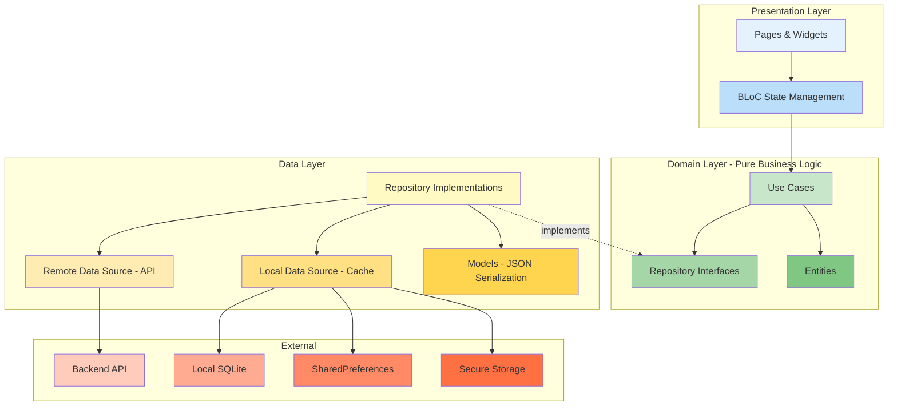
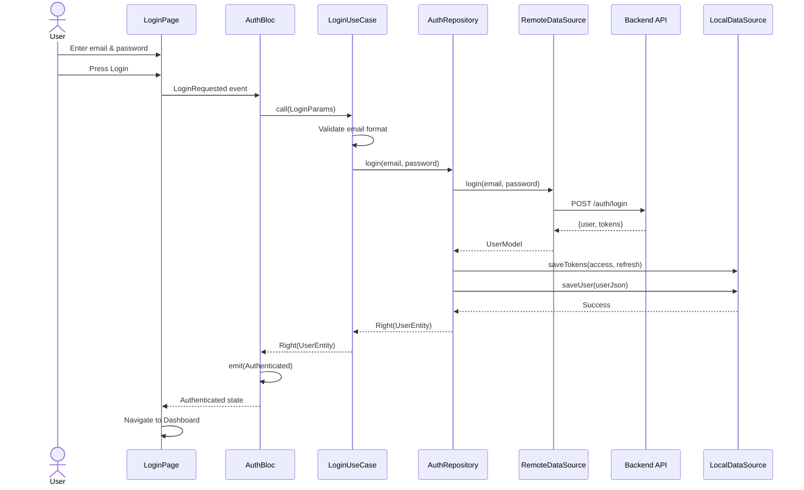
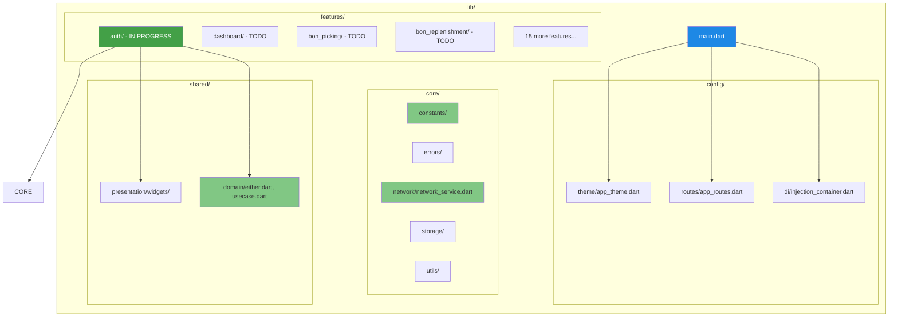
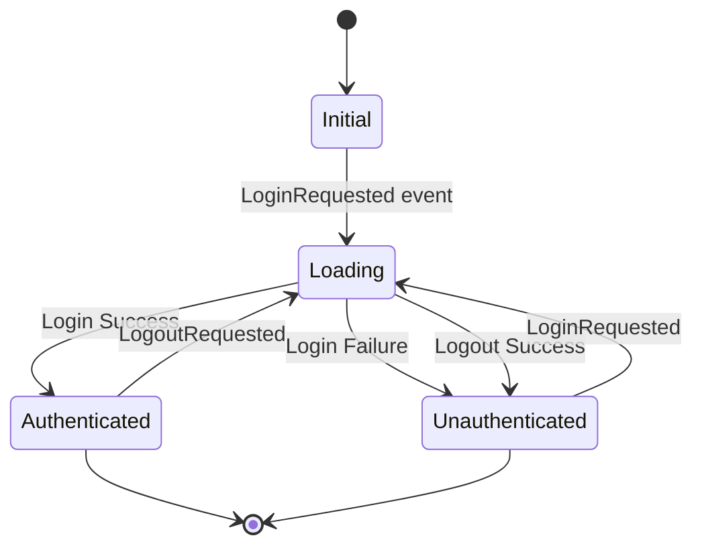
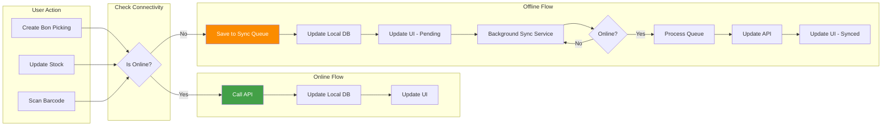
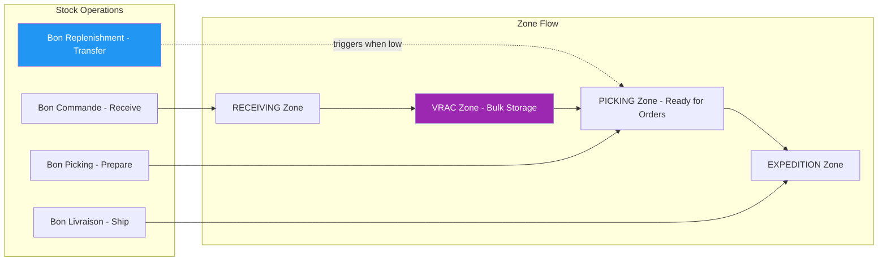
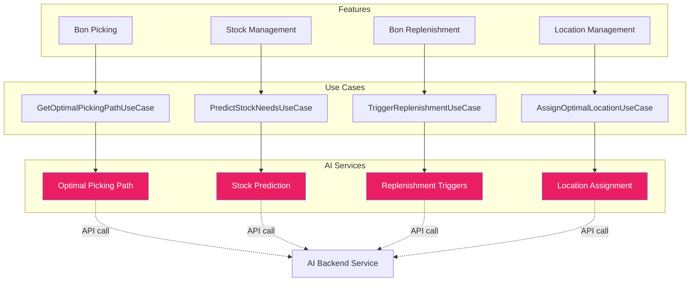

# MobAI Architecture Diagrams

## Clean Architecture Overview

## Login Flow Example

## Feature Organization

## Data Flow - BLoC Pattern

## Offline Sync Strategy

## VRAC Workflow (Database)

## AI Integration Points

---

**Legend:**
- 🟢 Green: Completed
- 🟠 Orange: In Progress
- 🔴 Red: Pending/TODO
- 🔵 Blue: External Service
- 🟣 Purple: AI/Smart Feature
